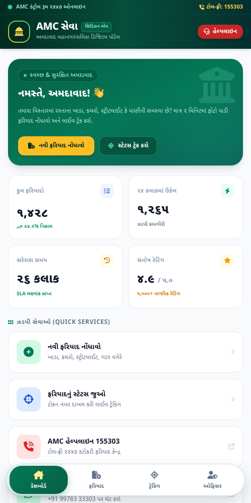
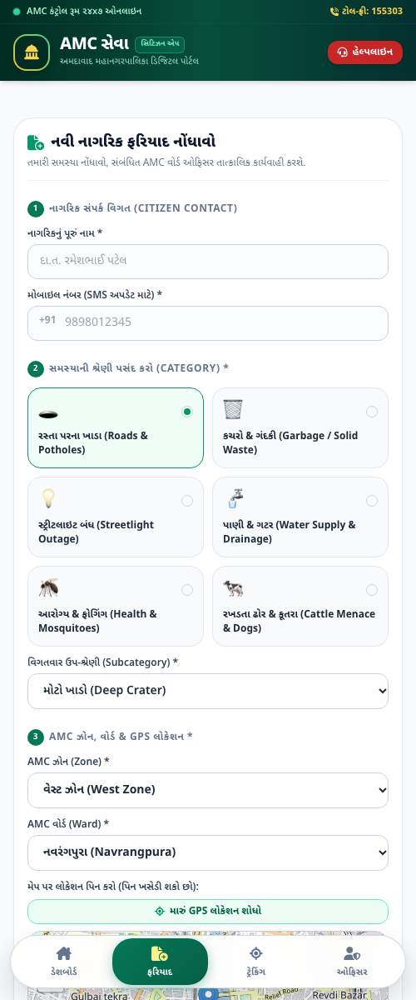

# અમદાવાદ મ્યુનિસિપલ કોર્પોરેશન (AMC) - સેવા પોર્ટલ & WhatsApp ઓટોમેશન
### AMC Seva - Civic Grievance Redressal & WhatsApp Automation Web App

[](https://github.com/lakumjay/amc)
[](https://github.com/lakumjay/amc)
[](https://github.com/lakumjay/amc)
[](https://github.com/lakumjay/amc)

---

## 📌 પરિચય (Overview)

અમદાવાદ મહાનગરપાલિકા (AMC) ના નાગરિકો માટે તૈયાર કરવામાં આવેલું અત્યાધુનિક, મોબાઇલ-ફર્સ્ટ સિવિક ગ્રીવન્સ (ફરિયાદ નિવારણ) અને **WhatsApp ઓટોમેશન પોર્ટલ**. 

આ સિસ્ટમ **સોલાર એપ (Solar App)** જેવી પ્રીમિયમ એમરાલ્ડ ગ્રીન (`#047857`, `#064e3b`) અને ગોલ્ડ થીમ પર આધારિત છે. તેમાં નાગરિકો માટે ફિક્સ ફ્લોટિંગ બોટમ નેવિગેશન બાર, વોઇસ સ્પીચ-ટુ-ટેક્સ્ટ, જીપીએસ મેપિંગ અને અધિકારીઓ માટે સમર્પિત પોર્ટલ ઉપલબ્ધ છે.

---

## 📸 એપ્લિકેશન સ્ક્રીનશોટ્સ (Screenshots)

| ૧. ડેશબોર્ડ (Dashboard View) | ૨. નવી ફરિયાદ (Complaint Form) |
| :---: | :---: |
|  |  |

---

## 🚀 મુખ્ય વિશેષતાઓ (Key Features)

1. **📱 ફિક્સ ફ્લોટિંગ બોટમ નેવબાર (App-like Bottom Navigation):**
   * 🏠 **ડેશબોર્ડ (Dashboard):** લાઈવ આંકડા (૧,૪૨૮ ફરિયાદો, ૯૪.૨% નિકાલ, ૨૬ કલાક સરેરાશ સમય, ૪.૯ રેટિંગ) અને તાજી સોલ્વ થયેલી ફરિયાદો.
   * 📝 **ફરિયાદ (New Complaint):** ફોટો અપલોડ, જીપીએસ લોકેશન અને વોઈસ નોટ સાથે ત્વરિત ફરિયાદ.
   * 🎯 **ટ્રેકિંગ (Track Status):** લાઈવ સ્ટેટસ પ્રોગ્રેસ બાર, સોલ્વ થયા પહેલા અને પછીના ફોટા (Before/After) અને ૫-સ્ટાર રેટિંગ.
   * 👮‍♂️ **ઓફિસર (Officer Portal):** વોર્ડ ઇન્સ્પેક્ટર અને સુપરવાઇઝર માટે લોગીન અને સ્ટેટસ અપડેટ પોર્ટલ.

2. **🗺️ અમદાવાદના તમામ ૭ ઝોન અને ૪૪+ વોર્ડ પ્રી-કોન્ફિગર્ડ:**
   * પશ્ચિમ ઝોન (નવરંગપુરા, નારણપુરા, પાલડી, વાડજ, ઉસ્માનપુરા વગેરે)
   * ઉત્તર પશ્ચિમ, દક્ષિણ પશ્ચિમ, મધ્ય, પૂર્વ, ઉત્તર અને દક્ષિણ ઝોન.

3. **📍 ૧૦૦% ફ્રી મેપિંગ (Leaflet + OpenStreetMap):**
   * Google Maps ની મોંઘી ફી વગર ઓપનસ્ટ્રીટમેપ અને લાઈવ જીપીએસ ડીટેક્ટર વડે સચોટ લોકેશન પિન.

4. **🎙️ ગુજરાતી વોઇસ સ્પીચ-ટુ-ટેક્સ્ટ:**
   * નાગરિકો ટાઈપ કર્યા વગર માઈક્રોફોન પર બોલીને સીધી ગુજરાતીમાં ફરિયાદ લખાવી શકે છે.

5. **💬 Meta WhatsApp Cloud API ઓટોમેશન:**
   * ફરિયાદ નોંધાતા જ ૨ સેકન્ડમાં નાગરિકના WhatsApp પર ટોકન ID અને વિગત.
   * ફરિયાદ સોલ્વ થતાં જ કામગીરી પૂર્ણ થયાનો ફોટો અને રેટિંગ લિંક WhatsApp પર મોકલાય છે.

---

## 💰 API & WhatsApp બિલિંગ પ્લાન (Pricing Breakdown)

પોર્ટલ માટે જરૂરી તમામ પેઇડ સેવાઓ અને WhatsApp મેસેજિંગ ચાર્જ માટે સત્તાવાર ગાઈડ સામેલ છે:
* 📄 **ડાઉનલોડ કરો:** [`AMC_Seva_API_Pricing_Guide.pdf`](AMC_Seva_API_Pricing_Guide.pdf)
* 🌐 **ઓનલાઈન રિપોર્ટ:** `pricing_proposal.html`

### WhatsApp ના દર (Meta 2026 India Rates):
* **સર્વિસ મેસેજ (નાગરિક શરૂ કરે):** ₹ ૦.૩૫ / સેશન *(પ્રથમ ૧,૦૦૦ સેશન દર મહિને ૧૦૦% મફત)*
* **યુટિલિટી એલર્ટ (ટોકન + સોલ્વ અપડેટ):** ₹ ૦.૧૧૫ / સેશન
* **ઓથેન્ટિકેશન (OTP):** ₹ ૦.૧૨૫ / OTP

### વોલ્યુમ મુજબ માસિક બિલ અંદાજ:
* **૫,૦૦૦ નાગરિકો:** ~ **₹ ૧,૯૭૫ / મહિને** (પ્રતિ ફરિયાદ માત્ર ₹ ૦.૩૯)
* **૧૦,૦૦૦ નાગરિકો:** ~ **₹ ૪,૩૦૦ / મહિને** (પ્રતિ ફરિયાદ માત્ર ₹ ૦.૪૩)
* **૨૫,૦૦૦ નાગરિકો:** ~ **₹ ૧૧,૨૭૫ / મહિને** (પ્રતિ ફરિયાદ માત્ર ₹ ૦.૪૫)
* **૫૦,૦૦૦ નાગરિકો:** ~ **₹ ૨૨,૯૦૦ / મહિને** (પ્રતિ ફરિયાદ માત્ર ₹ ૦.૪૫)

---

## 🔐 ઓફિસર લોગીન વિગત (Default Credentials)

* **એડમિન / સુપરવાઇઝર લોગીન:**
  * **યુઝરનેમ:** `admin`
  * **પાસવર્ડ:** `amc2026`
* **વોર્ડ ઓફિસર લોગીન:**
  * **યુઝરનેમ:** `officer`
  * **પાસવર્ડ:** `amc123`

---

## 🛠️ પ્રોજેક્ટ સ્ટ્રક્ચર (Project Structure)

```text
amc/
├── index.php                      # મુખ્ય એપ્લિકેશન (સોલાર એપ UI & બોટમ નેવબાર)
├── api.php                        # બેકેન્ડ REST API (ફરિયાદો, સ્ટેટ્સ, ઝોન/વોર્ડ ડેટા)
├── pricing_proposal.html          # ઇન્ટરેક્ટિવ ક્લાયન્ટ પ્રાઇસિંગ પ્રપોઝલ
├── AMC_Seva_API_Pricing_Guide.pdf # ૯૨૦ KB સત્તાવાર ડાઉનલોડેબલ બિલિંગ PDF
├── storage/
│   ├── complaints.json            # ફરિયાદોનો ડેટાબેઝ
│   └── uploads/                   # નાગરિક અને ઓફિસરના અપલોડ કરેલ ફોટા
├── docs/
│   └── screenshots/               # એપ્લિકેશન સ્ક્રીનશોટ્સ
└── README.md                      # દસ્તાવેજીકરણ
```

---

## 💻 લોકલ સેટઅપ (How to Run Locally)

1. આ રિપોઝીટરી ક્લોન કરો:
   ```bash
   git clone https://github.com/lakumjay/amc.git
   ```
2. ફોલ્ડરને તમારા લોકલ વેબ સર્વર (દા.ત. XAMPP `htdocs/amc-seva`) માં મૂકો.
3. બ્રાઉઝરમાં ઓપન કરો:
   ```text
   http://localhost/amc-seva/
   ```
4. `storage/` અને `storage/uploads/` ફોલ્ડરને રાઇટ પરમિશન (chmod 777) આપો.

---

© ૨૦૨૬ અમદાવાદ મહાનગરપાલિકા (AMC) | ઓલ રાઇટ્સ રિઝર્વ્ડ.
